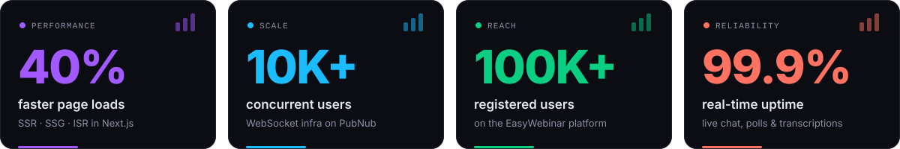
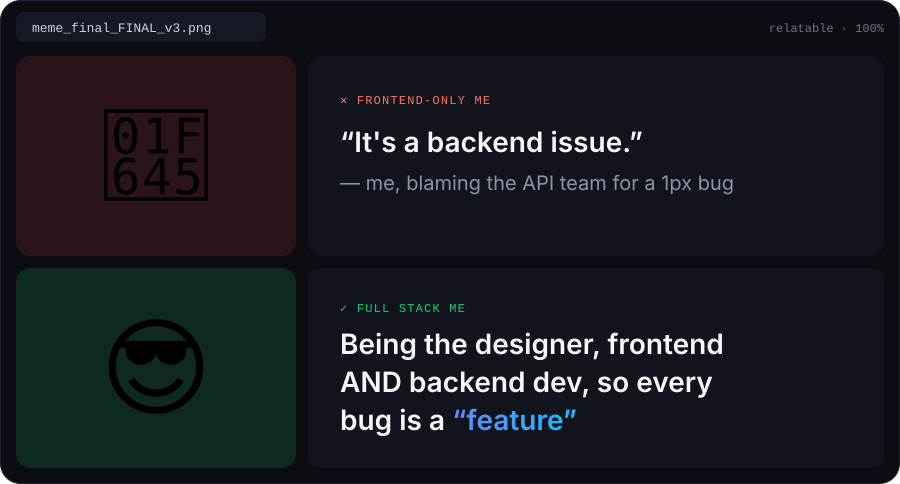

<!-- ───────────────────────────────  00 · COVER  ─────────────────────────────── -->

<p align="center">
  
</p>

<p align="center">
  <a href="https://github.com/shuboycode">
    
  </a>
</p>

<p align="center">
  <a href="https://shubham-kumar-dev.vercel.app"></a>
  <a href="https://www.linkedin.com/in/shubh-kumar-dev"></a>
  <a href="mailto:kumarshubham121998@gmail.com"></a>
</p>

<br />

<!-- ───────────────────────────────  01 · HELLO  ─────────────────────────────── -->

### `01` &nbsp;Hello, world <sub><sup>&nbsp;/ whoami</sup></sub>

<table>
<tr>
<td width="56%" valign="top">

```ts
const shubham = {
  role:      "SDE 1 · Full Stack Developer",
  basedIn:   "Hyderabad, India",
  shipping:  "5+ years of SaaS, CRMs & real-time apps",
  frontend:  ["React", "Next.js", "TypeScript", "Redux"],
  backend:   ["Node.js", "REST APIs", "MongoDB"],
  realtime:  ["PubNub", "WebSockets"],
  cloud:     ["AWS S3", "Azure DevOps", "Vercel"],
  edge:      "I also design the thing I build (Figma, UX, design systems)",
};
```

</td>
<td width="44%" valign="top">

**▸ Right now**

- 🧠 Building an **AI automation module** for a webinar platform with **100K+ users**
- ⚡ Running real-time chat, polls, Q&A & live transcription at **99.9% uptime**
- 🧩 Maintaining a **Storybook component library** shared by 5+ products
- 👥 Leading and mentoring a squad of **4 developers**

**▸ Ask me about**

`Next.js SSR / ISR` · `API design` · `real-time architecture` · `design systems` · `perf budgets`

</td>
</tr>
</table>

<br />

<!-- ───────────────────────────────  02 · IMPACT  ─────────────────────────────── -->

### `02` &nbsp;Impact, in numbers <sub><sup>&nbsp;/ receipts</sup></sub>

<p align="center">
  
</p>

<br />

<!-- ───────────────────────────────  03 · THE STACK  ─────────────────────────────── -->

### `03` &nbsp;The stack, layer by layer <sub><sup>&nbsp;/ client → server → data</sup></sub>

<table>
<tr>
<td width="150" align="center"><b>🖥️ Client</b><br /><sub>what users touch</sub></td>
<td>
  
  <br />
  
  
</td>
</tr>
<tr>
<td align="center"><b>⚙️ Server &amp; Data</b><br /><sub>what makes it work</sub></td>
<td>
  &nbsp;
  
  
  
</td>
</tr>
<tr>
<td align="center"><b>📡 Real-time &amp; Cloud</b><br /><sub>what keeps it live</sub></td>
<td>
  &nbsp;
  
  
</td>
</tr>
<tr>
<td align="center"><b>🎨 Design &amp; UX</b><br /><sub>my unfair advantage</sub></td>
<td>
  &nbsp;
  
  
  
  
</td>
</tr>
<tr>
<td align="center"><b>🤖 AI workflow</b><br /><sub>how I move fast</sub></td>
<td>
  
  
  
  
  
</td>
</tr>
</table>

<br />

<!-- ───────────────────────────────  04 · SELECTED WORK  ─────────────────────────────── -->

### `04` &nbsp;Selected work <sub><sup>&nbsp;/ shipped, not just designed</sup></sub>

<table>
<tr>
<td width="50%" valign="top">

#### 🎥 &nbsp;EasyWebinar Platform
<sub>`Next.js` `React` `PubNub` `WebSockets` `Redux` `Storybook`</sub>

A webinar SaaS with 100K+ registered users. I work across the product: the app UI, the real-time layer (live chat, polls, Q&A, transcription), and now an AI module that automates host workflows.

→ [app.easywebinar.com](https://app.easywebinar.com)

</td>
<td width="50%" valign="top">

#### 🤝 &nbsp;Catalyst Referrer
<sub>`Next.js` `TypeScript` `Redux Toolkit` `Axios` `MUI`</sub>

LinkedIn-style networking meets Naukri-style job referrals: complex profile and connection state, job-matching logic, advanced search, real-time notifications, and SSR/SSG for SEO.

</td>
</tr>
<tr>
<td width="50%" valign="top">

#### 💬 &nbsp;Blabber
<sub>`React` `RTK` `PubNub` `MUI`</sub>

A real-time chat app with media sharing and video calls. Messages arrive in **under 100ms**, and the UI follows WCAG 2.1 accessibility guidelines.

</td>
<td width="50%" valign="top">

#### 🌐 &nbsp;EasyWebinar Marketing Site
<sub>`Next.js` `WordPress` `SCSS` `Figma`</sub>

A conversion-focused site in Next.js, plus a WordPress variant, tuned for performance and SEO. I built it with the marketing and design teams.

→ [easywebinar.com](https://easywebinar.com)

</td>
</tr>
</table>

<details>
<summary><b>+ 1 more from the archive</b></summary>
<br />

**📰 TheBlackList**: a mobile-first newsletter reader that I designed and built with Vue + Vuetify. → [theblacklist.xyz](https://theblacklist.xyz)

</details>

<br />

<!-- ───────────────────────────────  05 · HOW I WORK  ─────────────────────────────── -->

### `05` &nbsp;How I work <sub><sup>&nbsp;/ principles</sup></sub>

<table>
<tr>
<td width="33%" valign="top" align="center">
<h3>🧱</h3>
<b>Own it end to end</b><br />
<sub>From the Figma frame to the API contract to the deploy. Fewer handoffs, fewer surprises.</sub>
</td>
<td width="33%" valign="top" align="center">
<h3>🎨</h3>
<b>Engineer with taste</b><br />
<sub>Clean architecture under the hood, considered UX on top. Users shouldn't feel the seams.</sub>
</td>
<td width="33%" valign="top" align="center">
<h3>🚀</h3>
<b>Ship like a user</b><br />
<sub>If it's slow on hotel Wi-Fi or confusing on day one, it isn't done.</sub>
</td>
</tr>
</table>

<br />

<!-- ───────────────────────────────  06 · OFF THE CANVAS  ─────────────────────────────── -->

### `06` &nbsp;Off the screen <sub><sup>&nbsp;/ the human behind the PRs</sup></sub>

<p align="center">
  
</p>

<p align="center"><sub>Drawing portraits taught me what I still use in every code review: <b>look longer than feels necessary.</b></sub></p>

<br />

<!-- ───────────────────────────────  07 · MEME BREAK  ─────────────────────────────── -->

### `07` &nbsp;Meme break <sub><sup>&nbsp;/ mandatory fun</sup></sub>

<p align="center">
  
</p>

<details>
<summary><b>🎲 Roll a random dev joke</b> <sub>(changes on every refresh)</sub></summary>
<br />
<p align="center">
  
</p>
</details>

<details>
<summary><b>🥚 Do not open</b></summary>
<br />

> You opened it anyway.
> That's exactly the kind of curiosity I look for in a teammate, and probably why you're a good one.
> **[Let's talk →](https://www.linkedin.com/in/shubh-kumar-dev)**

</details>

<br />

<!-- ───────────────────────────────  08 · ACTIVITY  ─────────────────────────────── -->

### `08` &nbsp;Commit rhythm <sub><sup>&nbsp;/ proof of life</sup></sub>

<p align="center">
  
  
</p>

<br />

<!-- ───────────────────────────────  09 · SAY HI  ─────────────────────────────── -->

### `09` &nbsp;Say hi <sub><sup>&nbsp;/ open a connection</sup></sub>

<p align="center">
  <b>Need someone who can take a product from idea → UI → API → production?</b><br />
  <sub>Happy to talk full stack architecture, real-time systems, design systems, or which pencil makes the best shadows (it's 4B).</sub>
</p>

<p align="center">
  <a href="https://www.linkedin.com/in/shubh-kumar-dev"></a>
  <a href="mailto:kumarshubham121998@gmail.com"></a>
</p>

<p align="center">
  <sub>🏆 “Relentless Learner · Frontend Force” &nbsp;·&nbsp; Spot Award for Outstanding Delivery</sub>
</p>

<p align="center">
  
</p>


